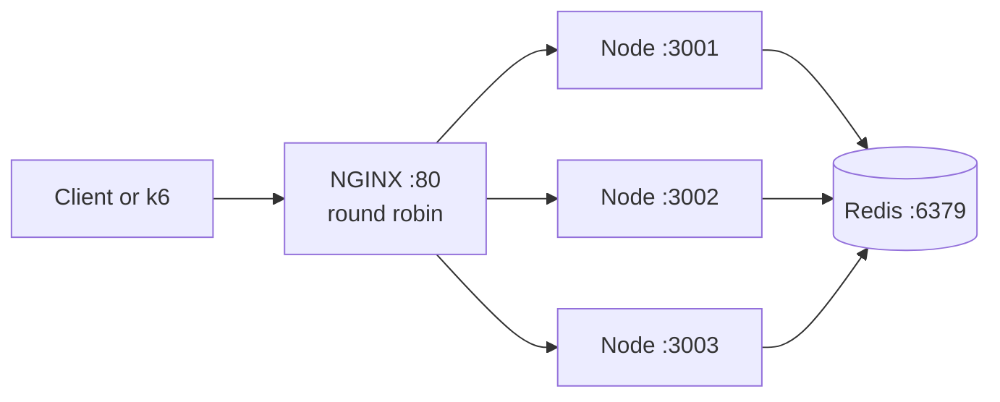
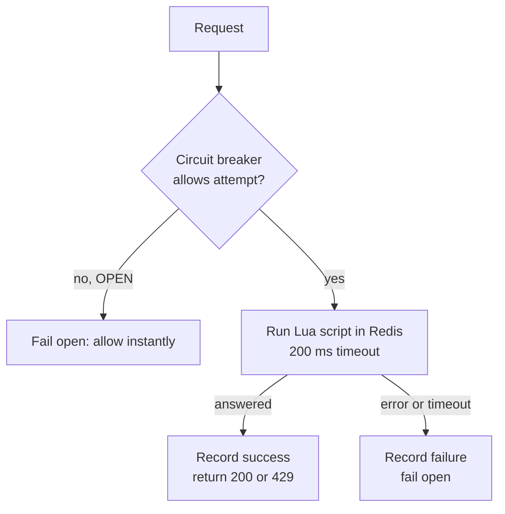

# Distributed Rate Limiter

A rate limiter that enforces one shared limit across multiple server instances. Three algorithms (token bucket, fixed window, sliding window) run as atomic Lua scripts inside Redis, behind an NGINX load balancer, with fail-open behaviour and a circuit breaker for Redis outages.

The interesting problem here is not the algorithms. It is keeping a single limit correct when several servers handle requests for the same user at the same moment.

## The problem

A rate limiter on one server is a counter in memory. Add a second server and each one keeps its own counter, so a user spread across three servers gets three times the limit.

Moving the counter to a shared store fixes that, but creates a second problem. If a server reads the count, decides, then writes it back as separate steps, two servers can read the same value before either writes. Both allow the request, and the limit is broken again.

This project solves both:

1. **Shared state.** All instances read and write one counter in Redis.
2. **Atomicity.** The read, the decision and the write run as a single Lua script, which Redis executes without interruption.

## Architecture



Each request follows the same path inside a Node instance:



## Algorithms

| Algorithm | Redis structure | Memory per key | Burst handling | Weakness |
|---|---|---|---|---|
| Token bucket | Hash: `tokens`, `lastRefill` | 2 values | Allows controlled bursts | Capacity and refill rate need tuning together |
| Fixed window | Hash: `windowStart`, `requestCount` | 2 values | All or nothing reset | Up to 2x the limit across a window boundary |
| Sliding window log | Sorted set of request timestamps | 1 entry per request | No boundary exploit | Memory grows with traffic |

## Design decisions

**Lua scripts for atomicity.** Each algorithm is a Lua script sent with `EVAL`. Redis runs a script start to finish with no other command in between, so no two instances can act on the same stale count.

**Data structure follows the algorithm.** Token bucket and fixed window store a fixed set of named fields, so they use hashes. Sliding window needs to drop timestamps older than the window in one step, which a sorted set does with `ZREMRANGEBYSCORE`.

**Keys expire on their own.** Token bucket and fixed window keys expire after an hour of inactivity. Sliding window keys expire just after the window length, since they are empty by then anyway.

**Refill is calculated, not scheduled.** There is no background timer adding tokens. Each request calculates how many tokens should have refilled since the last update.

**Fail open on Redis failure.** If Redis is unavailable, requests are allowed rather than blocked. Rate limiting is protection, not a security boundary, so a short window without limits is better than taking the whole API down. Set `FAIL_MODE=closed` to block instead.

**Circuit breaker.** After 3 consecutive failures the breaker opens and requests skip Redis entirely for 10 seconds. Then one request probes Redis. Success closes the breaker, failure reopens it. Without this, every request during an outage waits for a timeout before failing open.

**Bounded waits.** Every Redis call is capped at 200 ms. Redis on the same network answers in a few milliseconds, so anything slower means something is wrong.

**Automatic reconnect.** If the connection drops, the client retries with a growing delay capped at 2 seconds, so instances recover without a restart.

**One breaker per instance.** Breaker state lives in each Node process. Instances trip independently, which is acceptable because each one discovers the outage within a few requests.

## Results

### Concurrency: 100 simultaneous requests, limit of 10

Measured with k6, 100 virtual users each sending one request at the same moment through NGINX to three instances.

| Variation | Shared counter | Atomic | Allowed |
|---|---|---|---|
| In-memory per instance | No | No | 30 |
| Redis, separate read and write | Yes | No | In progress |
| Redis with Lua script | Yes | Yes | **10** |

Redis with Lua: p95 latency 19 ms under the burst.

### Fixed window boundary exploit

Limit of 5 requests per 5 seconds. Five requests just before a window boundary, five more just after.

| Algorithm | Allowed in about 0.3 seconds |
|---|---|
| Fixed window | 10 |
| Sliding window | 5 |

### Circuit breaker during a Redis hang

Redis frozen with `docker pause`, command timeout raised to 3 seconds to make the effect visible, 12 sequential requests across three instances.

| Requests | Time per request | Why |
|---|---|---|
| 1 to 9 | about 3 s | each instance reaches 3 failures |
| 10 to 12 | about 0.01 s | every breaker open, Redis skipped |

Also verified: a failed recovery probe reopens the breaker, and a successful one closes it.

## Running locally

**Prerequisites:** Node.js 24 (tested on 24.18), Docker Desktop.

```bash
npm install

# Redis and NGINX
docker-compose up -d

# three instances, one per terminal
PORT=3001 npm run dev
PORT=3002 npm run dev
PORT=3003 npm run dev
```

Then:

```bash
curl http://localhost/api/redis/token-bucket
```

## Endpoints

| Route | Storage | Algorithm |
|---|---|---|
| `GET /api/token-bucket` | In-memory | Token bucket |
| `GET /api/fixed-window` | In-memory | Fixed window |
| `GET /api/sliding-window` | In-memory | Sliding window |
| `GET /api/redis/token-bucket` | Redis + Lua | Token bucket |
| `GET /api/redis/fixed-window` | Redis + Lua | Fixed window |
| `GET /api/redis/sliding-window` | Redis + Lua | Sliding window |

All routes return `200` when allowed and `429` when limited, with a JSON body containing `message` and `remaining`. The in-memory routes exist for comparison and only work correctly with a single instance.

## Load testing

Tests run through the official k6 Docker image, so nothing extra is installed.

```bash
# reset the counter first
docker exec rate-limiter-redis-1 redis-cli DEL rate:global

# Redis with Lua (default)
docker run --rm -i grafana/k6 run - < loadtests/concurrency.js

# any other route
docker run --rm -i grafana/k6 run -e TARGET=/api/token-bucket - < loadtests/concurrency.js
```

k6 reports `429` responses as failed requests. For this test that is expected.

Boundary comparison:

```bash
node boundaryTest.js
```

## Project structure

```
.
├── server.js              Express app and routes
├── redisClient.js         Redis connection, reconnect strategy
├── redisRateLimiter.js    Runs Lua scripts with timeout, breaker and fail mode
├── circuitBreaker.js      CLOSED, OPEN, HALF_OPEN state machine
├── tokenBucket.js         In-memory token bucket
├── fixedWindow.js         In-memory fixed window
├── slidingWindow.js       In-memory sliding window
├── boundaryTest.js        Fixed vs sliding window at a boundary
├── lua/
│   ├── tokenBucket.lua
│   ├── fixedWindow.lua
│   └── slidingWindow.lua
├── loadtests/
│   └── concurrency.js     k6 burst test
├── nginx.conf             Round robin across three instances
└── docker-compose.yml     Redis and NGINX
```

## Limitations

- One global key per algorithm. Every client shares a single limit. Per-user limits are planned.
- The Node instances run outside Docker, so NGINX reaches them through `host.docker.internal`, and the client IP NGINX forwards is Docker's gateway address rather than the real one.
- In the sliding window, the request timestamp is also the sorted set member, so two requests in the same millisecond count as one.
- While the breaker is half open, every concurrent request is let through as a probe, not just one.

## Roadmap

- [ ] Redis without Lua, to isolate the effect of atomicity
- [ ] Algorithm comparison under steady load: latency and throughput
- [ ] Middleware to replace the repeated route handlers
- [ ] Per-user limits keyed by user or API key
- [ ] Unit tests for the three algorithms
- [ ] Node instances in Docker Compose, one command to start everything
- [ ] TLA+ specification of the token bucket
